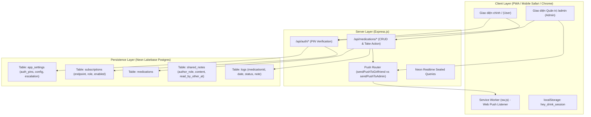

# V&D — Project Handover Document

> **Last Updated:** 2026-10-28  
> **Environment:** Node.js (v22+), Express, Neon Lakebase PostgreSQL, Web Push (VAPID / Apple APNs / Google FCM)  
> **Primary Roles:** `User` (Mã PIN: `9230`) | `Admin` (Mã PIN: `7777`)

---

## 1. Executive Summary

**Hey Let's Drink** is a progressive web application (PWA) designed for punctual medication adherence tracking, push notifications, and remote monitoring. 

Key features completed in this phase:
- **PIN-based Authentication & Permanent Session Persistence**: MoMo-style custom numeric keypad adhering strictly to the Saigon Digital design system (`design.md`).
- **Role Separation**:
  - **User (`9230`)**: Opens the main medication schedule interface (`/`). Does not have access to `/admin`.
  - **Admin (`7777`)**: Full access to both `/` and the Admin Dashboard (`/admin`).
- **Message Note on Dose Confirmation (💬)**: An optional custom note attached to medication confirmation.
- **Strict Notification Routing**:
  - **Admin**: **Chỉ nhận thông báo khi User có gửi kèm lời nhắn ghi chú**, hoàn toàn không bị làm phiền bởi chuông nhắc nhở uống thuốc định kỳ.
  - **User**: Nhận thông báo đúng giờ cữ thuốc, chuông tăng tốc dồn dập Anki (10p, 15p, 17p, khẩn cấp) và thông báo nhắc nhở tức thì.
- **Neutral System Voice**: 100% văn phong trung lập kỹ thuật ("User", "Admin", "Ghi chú cữ thuốc", "Thiết bị"), gỡ bỏ toàn bộ từ ngữ xưng hô thân mật trong hệ thống.
- **Component Consistency**: Đồng bộ nút bánh răng cài đặt (`.btn-icon-gear`), công tắc gạt (`.toggle-switch`), modal bottom-sheet, và bàn phím số MoMo trên toàn bộ ứng dụng.

---

## 2. Architecture & Tech Stack



---

## 3. Credentials & Access

| Role | Default PIN | Quyền truy cập | Nơi đổi mã PIN |
|---|---|---|---|
| **User** | `9230` | Màn hình chính (`/`) | Trang `/admin` $\rightarrow$ Cài đặt ⚙️ $\rightarrow$ Quản Lý Mã PIN |
| **Admin** | `7777` | Màn hình chính (`/`) + Quản trị (`/admin`) | Trang `/admin` $\rightarrow$ Cài đặt ⚙️ $\rightarrow$ Quản Lý Mã PIN |

> **Lưu ý:** Cả hai mã PIN được lưu trong bảng `app_settings` (`key = 'auth_pins'`) trên Neon Postgres. Có thể cập nhật trực tiếp qua API `POST /api/admin/update-pins`.

---

## 4. Key Features & Implementation Details

### 4.1. MoMo-Style Custom Keypad & PIN Lock
- **Visuals**: Hộp capsule 4 chấm tròn (`.pin-dots-container`, `.pin-dot.filled`).
- **Layout**: Grid 3x4 bao gồm phím số `1-9`, phím xoá hết `C`, phím `0`, và phím lùi `⌫`.
- **Hành động**: Nút bấm màu xanh mang nhãn **"Tiếp"** (`.pin-btn-next`), tự động kích hoạt khi nhập đủ 4 số.
- **Phản hồi người dùng**: Hiệu ứng rung lắc (`pinShake` animation) và viền đỏ cảnh báo khi nhập sai PIN.
- **Hỗ trợ thiết bị**: Nhận cả cảm ứng chạm màn hình và phím cứng trên máy tính (`0-9`, `Backspace`, `Enter`, `Escape`).

### 4.2. Confirmation with Note (Ghi Chú Cữ Thuốc)
- Nút bong bóng chat 💬 nằm cạnh nút *"Đánh dấu đã uống"*.
- Mở bottom-sheet modal cho phép nhập ghi chú văn bản tự do (tối đa 100 ký tự).
- Khi xác nhận:
  1. Ghi nhận lượt uống thuốc vào bảng `logs` với cột `note`.
  2. Bắn thông báo đẩy tức thì tới thiết bị Admin (`sendPushToAdmin`) chứa nội dung ghi chú.
  3. Nếu xác nhận uống thông thường (không có ghi chú), Admin **không** nhận thông báo.

### 4.3. Admin Settings & Dashboard Consistency
- Nút bánh răng cài đặt (`.btn-icon-gear`) trên `/admin` đồng nhất 100% với giao diện app chính:
  - Mở bottom-sheet modal cài đặt gồm:
    - Công tắc Toggle Switch (`.toggle-switch`) bật/tắt nhận thông báo Admin trên thiết bị hiện tại.
    - Nút gửi thử nghiệm thông báo Admin (`POST /api/test-push` với `target: 'admin'`).
    - Cài đặt đổi mã PIN bảo mật cho cả User và Admin.
    - Trạng thái phiên đăng nhập và nút **"Đăng xuất"** (đã tích hợp cờ chống click đúp `isLoggingOut`).
- Trên màn hình Admin hiển thị:
  - Danh sách cữ thuốc hôm nay với huy hiệu trạng thái (Đã uống, Quá hạn, Chưa đến cữ).
  - Huy hiệu lời nhắn 💬 kèm nội dung khi User có nhập ghi chú.
  - Cấu hình chuông tăng tốc Anki (10p, 15p, 17p, khẩn cấp) với các câu nhắc nhở tùy chỉnh.
  - Form gửi lời nhắc thông báo màn hình khóa tức thì.

### 4.4. Streak Logic
- Chuỗi ngày uống thuốc liên tiếp (**Streak**) được tính toán chặt chẽ:
  - Một ngày chỉ được tính vào chuỗi **khi và chỉ khi toàn bộ các cữ thuốc theo lịch của ngày đó đã được uống đủ 100%** (hàm `isDateFullyCompleted(dateStr)`).
  - Nếu ngày hôm nay còn cữ chưa uống (ví dụ 7/8 cữ), chuỗi hôm nay chưa tăng nhưng chuỗi các ngày trước đó vẫn được bảo toàn.

---

## 5. Network & Stability Optimizations

- **IPv4 DNS Priority**: 
  - Khởi động với cờ `--dns-result-order=ipv4first` và thiết lập `dns.setDefaultResultOrder('ipv4first')` tại đầu file [server.js](file:///home/levi/Desktop/Projects/hey-lets-drink/server.js).
  - Tránh tình trạng Node.js trên Linux bị timeout 10s khi cố gắng phân giải địa chỉ IPv6 tới Neon Lakebase Postgres.
- **Process Crash Protection**:
  - Bổ sung `process.on('uncaughtException')` và `process.on('unhandledRejection')` bảo vệ server không bị ngắt quãng khi Neon DB gặp sự cố mạng chớp nhoáng.
- **Mobile Viewport Clearance**:
  - Modal Bottom Sheet được trang bị `padding-bottom: calc(env(safe-area-inset-bottom, 24px) + 70px);` và `overscroll-behavior-y: contain;` đảm bảo cuộn mượt mà và không bao giờ bị che khuất bởi thanh điều hướng Safari/Chrome trên mobile.

- **Shared Notes (Chat Box / Không gian riêng tư)**:
  - **Vị trí**: Nằm gọn gàng bên trong menu Cài đặt bánh răng (⚙️).
  - **Thiết kế dạng Chat Box (iMessage / Messenger style)**:
    - Cuộn dọc chuyên dụng (`height: 88dvh`), thanh nhập tin nhắn cố định ở đáy (Sticky Bottom Bar).
    - **Nút chuyển đổi Toàn màn hình (Full Screen)**: Cho phép mở rộng 100vw × 100dvh để đọc và gõ các tâm sự dài thoải mái nhất.
    - **Header Tối giản**: Tiêu đề tinh gọn `Note [User]` / `Note [Admin]`, đã gỡ bỏ dòng phụ `Không gian riêng tư`.
    - **Hỗ trợ Emoji gốc thiết bị (Native Emojis)**: Nhập và hiển thị trực tiếp bộ emoji gốc của iPhone (`Apple Color Emoji`) và Android (`Noto Color Emoji`) mà không cần nạp thêm bất kỳ thư viện bên thứ 3 nào (0kb bundle overhead).
    - Khung tin nhắn dạng bóng bóng chat đối thoại, tối ưu cho tin nhắn dài (`font-size: 15px`, `line-height: 1.62`).
    - Hiển thị văn bản rỗng tối giản **"Nhập gì đó..."**.
  - **Chỉnh sửa & Gỡ tin nhắn trong 10 phút (Edit & Recall)**:
    - Người gửi có thể bấm **Sửa** (icon bút chì) hoặc **Gỡ** (icon thùng rác) tin nhắn trong vòng **10 phút**.
    - Nút tuỳ chọn được thiết kế dạng **icon tối giản (`.chat-icon-btn`), trong suốt, hover xám nhạt (`#E2E8F0`)**, hoàn toàn không gây phân tâm hay chướng mắt khi đọc tin nhắn dài.
    - Hộp thoại xác nhận gỡ tin nhắn hoặc đăng xuất là **Modal tuỳ biến in-app (`.custom-confirm-card`)**, thay thế 100% dialog mặc định của trình duyệt (`window.confirm`).
    - Sau 10 phút, các nút hành động tự động ẩn và hệ thống backend từ chối can thiệp để bảo toàn lịch sử trò chuyện.
    - Tin nhắn sau khi sửa sẽ có huy hiệu tinh tế `· Đã sửa` đi kèm mốc thời gian.
  - **Bảo mật & Tĩnh lặng**: **Hoàn toàn KHÔNG gửi Web Push Notification ra bên ngoài**. Chỉ khi mở web app vào xem mới thấy.
  - **Thời gian thực (Neon Realtime)**: Cập nhật tức thì khi đối phương gửi ghi chú nếu ứng dụng đang mở, đồng bộ qua `@neon/realtime/server` (Sealed Query: `sealedNotes`).
  - **Chỉ báo thông minh**: Hiển thị chấm xanh tinh tế (`• Mới`) trên biểu tượng bánh răng và hàng menu khi có tin nhắn chưa đọc từ đối phương; tự động đánh dấu đã đọc khi người nhận mở xem.

### 4.5. Personalized Dynamic Header Greeting
- Thanh tiêu đề trang chủ tự động đổi từ `V&D` thành lời chào cá nhân hóa theo vai trò đăng nhập:
  - Khi **Vi** (PIN `7777` - Admin) đăng nhập: hiển thị **`Hi, Vi`**.
  - Khi **Duyen** (PIN `9230` - User/Girlfriend) đăng nhập: hiển thị **`Hi, Duyen`**.
  - Tự động hiển thị ngay lập tức khi mở app dựa trên phiên lưu trữ `localStorage`.

---

## 6. Verification Checklist

- [x] **Đăng nhập PIN User (`9230`)**: Mở khoá màn hình chính, kiểm tra thông tin hiển thị vai trò `User`.
- [x] **Bảo vệ trang Admin (`/admin`)**: Nếu chưa có session Admin, hiển thị overlay yêu cầu mã PIN `7777`.
- [x] **Nút vào Admin từ App chính**: Khi đăng nhập bằng `7777`, trong cài đặt bánh răng ⚙️ xuất hiện nút *"Admin"*.
- [x] **Đăng xuất 1 chạm**: Bấm Đăng xuất chỉ hiển thị hộp thoại xác nhận 1 lần duy nhất, xoá session và quay về màn hình khoá.
- [x] **Uống thuốc kèm lời nhắn**: Bấm 💬 cữ thuốc, nhập ghi chú $\rightarrow$ Server lưu note vào `logs` và gửi Web Push đến Admin.
- [x] **Uống thuốc không lời nhắn**: Bấm nút *"Đã uống"* $\rightarrow$ Lưu log nhưng KHÔNG gửi push cho Admin.
- [x] **Bánh răng trang Admin**: Nút ⚙️ mở modal bottom-sheet chứa toggle thông báo, đổi PIN và đăng xuất.
- [x] **Văn phong trung lập**: Không còn bất kỳ từ ngữ "bạn trai" hay "bạn gái" nào trong toàn bộ mã nguồn.
- [x] **Tinh chỉnh UI gọn gàng**: Đổi nút *"Đánh dấu đã uống"* thành *"Đã uống"*, xoá dòng thời gian thừa ở đầu danh sách, và bỏ icon cửa sổ trên nút vào Admin.

---

## 7. Useful Commands

```bash
# Cài đặt thư viện
npm install

# Khởi chạy server development (ưu tiên IPv4)
npm start

# Build client bundle (nếu có thay đổi client scripts)
npm run build

# Kiểm tra cú pháp mã nguồn
node -c server.js && node -c db.js && node -c public/app.js

# Kiểm tra dữ liệu trạng thái Admin qua API
curl -s http://localhost:3005/api/admin/status | jq .
```
